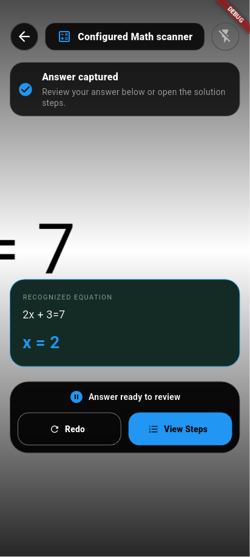
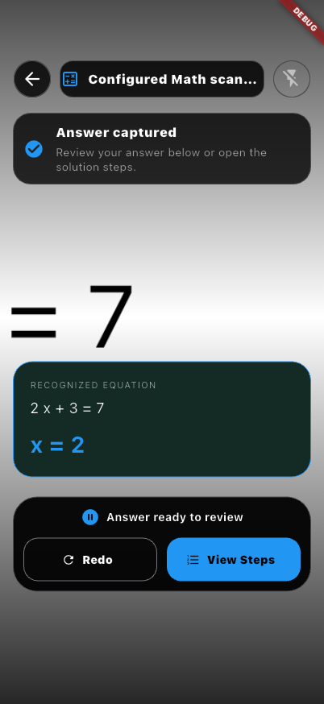

# Visual demos

AresMath uses the AresScan+ equation scanning flow: point at one equation, hold it steady, watch the countdown, then review the captured equation and answer. Gallery input and manual correction are included in the supplied route. Embedded mode exposes the same capture engine under your own controls.

- [Supplied screen and styling](scanner-screen.md)
- [Embedded camera and callbacks](embedded-camera.md)
- [Runnable package example](example-project.md)
- [AresScan+](https://aresdefencelabs.com/ares-scan)

The media directory contains only reviewed demonstration assets. Screenshots are examples of UI behavior, not a recognition-accuracy benchmark. Optional handwriting models and actual store delivery require the platform configuration described in [model delivery](model-delivery.md).

## Compiled consumer screenshots

These debug integration-test captures use a synthetic equation photograph and a configured blue accent/title. They demonstrate the actual native recognition result and captured-answer UI; they are not an accuracy benchmark or a live-camera scene.

 
